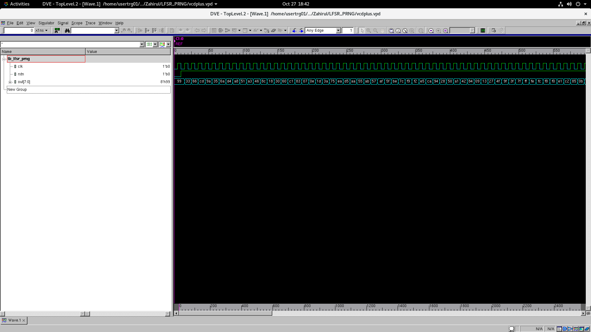
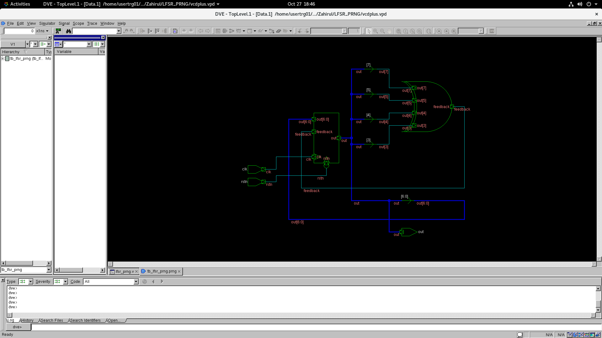

# 8-Bit LFSR Pseudo Random Number Generator

An 8-bit pseudo random number generator using a Linear Feedback Shift Register (LFSR), written in Verilog.

## How It Works

The LFSR uses the primitive polynomial:

```text
P(x) = x^8 + x^6 + x^5 + x^4 + 1
```

The polynomial is over the Galois Field, GF(2), where addition is the same as XOR. The feedback is generated by XORing the following bits:

```verilog
assign feedback = out[7] ^ out[5] ^ out[4] ^ out[3];
```

On every rising edge of the clock, the register shifts left and the feedback is inserted into the least significant bit:

```verilog
out <= {out[6:0], feedback};
```

With a nonzero seed, the LFSR cycles through all 255 possible nonzero 8-bit states before repeating, since `2^8 - 1 = 255`.

## Reset and Initial Seed

`rstn` is an active-low asynchronous reset. When it is low, the output is set to the initial seed:

```verilog
out <= 8'b1001_1001;
```

The initial seed is 153 in decimal. It must not be all zeros because an all-zero state produces zero feedback and remains stuck at zero. Resetting the LFSR starts the same sequence again.

## Module Signals

| Signal | Direction | Description |
| --- | --- | --- |
| `clk` | Input | Updates the LFSR on the rising edge. |
| `rstn` | Input | Active-low asynchronous reset. |
| `out[7:0]` | Output | Current 8-bit pseudo random value. |

## Testbench

The SystemVerilog testbench generates a clock with a 10 ns period. It initially holds reset low, then releases it on the first falling edge of the clock. The simulation runs for another 256 falling clock edges before finishing.

`$monitor` prints the output in binary and decimal. The sequence starts as follows:

```text
PRNG = 10011001 (153)
PRNG = 00110011 (51)
PRNG = 01100110 (102)
PRNG = 11001101 (205)
PRNG = 10011010 (154)
```

The recorded simulation output is in [lfsr_prng_output.txt](lfsr_prng_output.txt).

## Simulation Waveform



## Schematic


